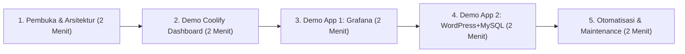

# Panduan Demo & Presentasi Pekan ke-7 (Projek KDJK Kelompok 4)

Dokumen ini disusun sebagai panduan praktis dan skenario demonstrasi langsung (*live demo*) saat presentasi di hadapan dosen penguji dan asisten praktikum.

---

## 1. Persiapan Sebelum Presentasi (H-1 / Sebelum Maju)

- [ ] **VM Aktif & Jaringan Stabil**:
  - Pastikan Ubuntu VM di VirtualBox/VMware berjalan.
  - Pastikan koneksi internet VM aktif (bisa ping `1.1.1.1` atau `google.com`).
- [ ] **Pemeriksaan Status Layanan**:
  ```bash
  # Cek status kontainer Docker
  docker ps

  # Cek status Cloudflare Tunnel
  sudo systemctl status cloudflared
  ```
- [ ] **Uji Coba Akses Domain Publik via Smartphone / Laptop Luar**:
  - `https://coolify.example.com`
  - `https://grafana.example.com`
  - `https://wordpress.example.com`
  - *Pastikan gembok hijau HTTPS aktif tanpa peringatan sertifikat SSL.*

---

## 2. Skenario Urutan Presentasi Live Demo (Total: ±10 Menit)



### Menit 01–02: Latar Belakang & Arsitektur Solusi
- **Poin yang Disampaikan:**
  - Menjelaskan bahwa kelompok memilih **Coolify v4** sebagai platform PaaS open-source mandiri (*self-hosted*).
  - Menjelaskan tantangan jaringan: Mesin virtual berjalan di laptop lokal di balik jaringan kampus / WiFi rumah yang menerapkan **CGNAT** (tanpa IP publik statis dan port 80/443 terblokir).
  - Solusi: Menggunakan **Cloudflare Tunnel (`cloudflared`)** yang membuat terowongan terenkripsi *outbound* ke edge Cloudflare, sehingga aman, tanpa *port forwarding*, dan otomatis memiliki sertifikat SSL/TLS valid.

### Menit 03–04: Demo Dashboard Coolify (PaaS Core)
- **Aksi yang Ditampilkan:**
  1. Buka browser dan buka `https://coolify.example.com`.
  2. Tunjukkan menu **Servers** > **localhost**:
     - Status Docker Engine aktif.
     - Reverse Proxy Traefik berjalan untuk merutekan subdomain secara otomatis.
  3. Tunjukkan menu **Projects** yang memuat dua aplikasi demo yang sedang aktif.

### Menit 05–06: Demo Aplikasi 1 — Grafana (Observabilitas & Metrik)
- **Aksi yang Ditampilkan:**
  1. Buka tab baru: `https://grafana.example.com`.
  2. Login dengan akun demo: `admin` / `adminpassword123`.
  3. Buka dashboard metrik yang sudah disiapkan.
  4. Tunjukkan bahwa Grafana berjalan di dalam kontainer terisolasi yang di-deploy dan dimonitor langsung oleh Coolify.

### Menit 07–08: Demo Aplikasi 2 — WordPress + MySQL (Aplikasi Web Multi-Tier)
- **Aksi yang Ditampilkan:**
  1. Buka tab baru: `https://wordpress.example.com`.
  2. Tunjukkan halaman beranda WordPress yang sudah berisi artikel nyata (bukan kosongan), tema visual yang rapi, dan judul situs kelompok.
  3. Masuk ke halaman admin (`/wp-admin`):
     - Tunjukkan bahwa data artikel tersimpan secara persisten di kontainer MySQL.
     - Jelaskan bahwa kedua kontainer terhubung via internal Docker network bridge yang dikelola oleh Traefik Coolify.

### Menit 09–10: Otomatisasi, Pemeliharaan & Penutup
- **Aksi yang Ditampilkan:**
  1. Tampilkan berkas [`setup.sh`](setup.sh):
     - Jelaskan bahwa seluruh alur mulai dari instalasi Docker, Coolify, Cloudflare Tunnel, hingga pengaturan domain telah diotomatisasi secara interaktif maupun non-interaktif.
  2. Tampilkan skrip pemeliharaan [`backup.sh`](backup.sh):
     - Tunjukkan bagaimana backup database Coolify dan MySQL WordPress dijalankan dalam satu perintah.
  3. Sebutkan perbandingan singkat dengan alternatif seperti Dokku dan CapRover (sebagaimana tercantum di laporan `README.md`).

---

## 3. Antisipasi Pertanyaan Dosen Penguji (Q&A Cheat Sheet)

**Q1: Mengapa memilih Coolify daripada Dokku atau CapRover?**
> *Jawaban:* Coolify memiliki UI modern berbasis web yang komprehensif, mendukung multi-server secara native via SSH, menyediakan lebih dari 280+ template aplikasi siap pakai (*1-click services*), dan menggunakan Traefik yang sangat fleksibel untuk manajemen sertifikat dan subdomain dinamis.

**Q2: Mengapa menggunakan Cloudflare Tunnel dan bukan Port Forwarding biasa?**
> *Jawaban:* Port forwarding biasa memerlukan IP publik statis dan akses penuh ke router ISP (yang biasanya diblokir oleh ISP rumah tangga atau jaringan kampus dengan CGNAT). Cloudflare Tunnel menggunakan koneksi *outbound* murni, menjaga port lokal tetap tertutup dari scanning publik, dan memberikan proteksi DDoS serta sertifikat SSL resmi tanpa biaya tambahan.

**Q3: Bagaimana jika VM dimatikan atau laptop berpindah koneksi WiFi?**
> *Jawaban:* Seluruh layanan Coolify, Docker, dan daemon `cloudflared` telah dikonfigurasi sebagai *systemd service* dengan restart policy `unless-stopped`. Begitu VM menyala dan mendapatkan koneksi internet, tunnel akan otomatis terhubung kembali ke edge Cloudflare tanpa perlu mengubah konfigurasi DNS atau IP.
