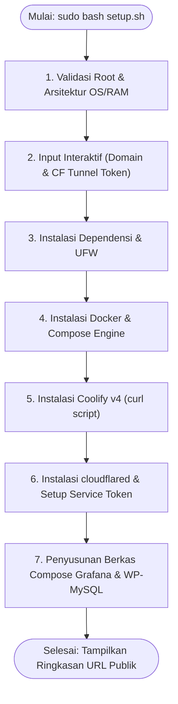

# Projek_KDJK_kel4_P2
Aplikasi PaaS Coolify

<p align="center">
  
</p>

<p align="center">
  <a href="#sekilas-tentang">Sekilas Tentang</a> •
  <a href="#instalasi">Instalasi</a> •
  <a href="#konfigurasi">Konfigurasi</a> •
  <a href="#maintenance">Maintenance</a> •
  <a href="#otomatisasi">Otomatisasi</a> •
  <a href="#cara-pemakaian">Cara Pemakaian</a> •
  <a href="#pembahasan">Pembahasan</a> •
  <a href="#referensi">Referensi</a>
</p>

---
## Anggota Kelompok

| No. | Nama | NIM |
|---:|---|---|
| 1 | **Hauzan Ziyadatul Khoir** | M0403241002 |
| 2 | **Muhammad Zakwan Sakhiy** | M0403241057 |
| 3 | **Harya Bagus Prayoga** | M0403241066 |
| 4 | **Azra Aslam Khoiri** | M0403241148 |
| 5 | **Afdha Auliya Atiq** | M0403241163 |

# Sekilas Tentang
[`^ kembali ke atas ^`](#Projek_KDJK_kel4_P2)

**Coolify** adalah platform *Platform-as-a-Service* (PaaS) *open-source* dan mandiri (*self-hosted*) yang dirancang sebagai alternatif independen terhadap layanan cloud komersial seperti Heroku, Vercel, Netlify, atau Render. Coolify memungkinkan pengembang untuk mengelola siklus hidup aplikasi web, basis data terkelola, manajemen kontainer Docker, hingga konfigurasi *reverse proxy* secara terpusat melalui antarmuka web modern yang intuitif.

```
+-------------------------------------------------------------------------------+
|                             ARSITEKTUR UMUM SISTEM                            |
+-------------------------------------------------------------------------------+
|                                                                               |
|   [ Internet Publik ]                                                         |
|           |                                                                   |
|           v (HTTPS :443)                                                      |
|   [ Cloudflare Edge Network ] (Universal SSL/TLS & DDoS Protection)           |
|           |                                                                   |
|           | <== (Encrypted Outbound Tunnel: QUIC / HTTP/2)                    |
|           v                                                                   |
|   +-----------------------------------------------------------------------+   |
|   | Local Ubuntu VM (Behind NAT / CGNAT - No Open Ports Required)         |   |
|   |                                                                       |   |
|   |   +------------------+                                                |   |
|   |   | cloudflared      | (Daemon Tunnel Penghubung)                     |   |
|   |   +--------+---------+                                                |   |
|   |            |                                                          |   |
|   |            +-----------------------+                                  |   |
|   |            | (Host: coolify.domain)| (Host: grafana/wp.domain)        |   |
|   |            v (:8000)               v (:80)                            |   |
|   |   +------------------+    +-----------------------+                   |   |
|   |   | Coolify Core API |    | Traefik Reverse Proxy |                   |   |
|   |   | & Dashboard Web  |    +-----------+-----------+                   |   |
|   |   +------------------+                |                               |   |
|   |                               +-------+-------+                       |   |
|   |                               |               |                       |   |
|   |                               v               v                       |   |
|   |                       +---------------+ +---------------+             |   |
|   |                       | Demo App 1:   | | Demo App 2:   |             |   |
|   |                       | Grafana (:3000| | WordPress:80  |             |   |
|   |                       +---------------+ +-------+-------+             |   |
|   |                                                 | (Internal Bridge)   |   |
|   |                                                 v                     |   |
|   |                                         +---------------+             |   |
|   |                                         | MySQL DB:3306 |             |   |
|   |                                         +---------------+             |   |
|   +-----------------------------------------------------------------------+   |
+-------------------------------------------------------------------------------+
```

Pada tugas projek ini, Coolify diinstal di dalam mesin virtual lokal (**Ubuntu VM**) yang berada di balik jaringan lokal pengguna (NAT / CGNAT). Agar aplikasi dan seluruh layanannya dapat diakses secara publik dan aman oleh dosen maupun rekan sejawat tanpa memerlukan IP publik statis atau konfigurasi *port-forwarding* rumit di router, diintegrasikan **Cloudflare Tunnel (`cloudflared`)**. 

Sebagai pembuktian fungsi PaaS, pada instance Coolify ini di-deploy dua aplikasi demo representatif:
1. **Grafana**: Platform observabilitas, monitoring sistem, dan visualisasi metrik data.
2. **WordPress + MySQL**: Aplikasi *Content Management System* (CMS) populer yang memanfaatkan relasi basis data multi-kontainer dengan penyimpanan data persisten (*persistent volume*).

---

# Instalasi
[`^ kembali ke atas ^`](#Projek_KDJK_kel4_P2)

### Kebutuhan Sistem

#### 1. Perangkat Keras (Hardware Minimal):
- **CPU**: Minimal 2 vCPU Core (Rekomendasi: 4 Core untuk kompilasi dan multi-kontainer).
- **RAM**: Minimal 2 GB (Rekomendasi: 4 GB+ agar Coolify, Traefik, Grafana, dan WordPress-MySQL dapat berjalan mulus bersamaan).
- **Disk**: Minimal 30 GB SSD.
- **Arsitektur**: x86_64 (amd64) atau ARM64 (aarch64).

#### 2. Perangkat Lunak & Jaringan:
- **Sistem Operasi Host/VM**: Ubuntu 22.04 LTS / 24.04 LTS (atau Debian 11/12).
- **Virtual Machine Manager**: VirtualBox, VMware Workstation, Proxmox VE, Hyper-V, atau KVM.
- **Jaringan**: Akses internet keluar (*outbound internet access*) aktif.
- **Domain Publik**: Domain pribadi (misal dari Freenom, Niagahoster, Namecheap, Cloudflare Registrar, dll.) yang terdaftar pada akun Cloudflare.

---

### Langkah Instalasi Manual (CLI Step-by-Step)

Bagi yang ingin melakukan instalasi tahap demi tahap tanpa menggunakan skrip otomatisasi:

#### 1. Masuk ke Server Ubuntu VM via SSH
```bash
ssh user@<IP-LOKAL-VM>
```

#### 2. Perbarui Repositori dan Pasang Paket Dasar
```bash
sudo apt update && sudo apt upgrade -y
sudo apt install -y curl wget git jq ufw ca-certificates gnupg lsb-release
```

#### 3. Pasang Docker Engine & Docker Compose Plugin Resmi
Coolify membutuhkan Docker Engine versi modern:
```bash
# Tambahkan GPG key resmi Docker
sudo install -m 0755 -d /etc/apt/keyrings
curl -fsSL https://download.docker.com/linux/ubuntu/gpg | sudo gpg --dearmor -o /etc/apt/keyrings/docker.gpg
sudo chmod a+r /etc/apt/keyrings/docker.gpg

# Tambahkan repositori apt Docker
echo \
  "deb [arch=$(dpkg --print-architecture) signed-by=/etc/apt/keyrings/docker.gpg] https://download.docker.com/linux/ubuntu \
  $(lsb_release -cs) stable" | sudo tee /etc/apt/sources.list.d/docker.list > /dev/null

# Instalasi paket Docker
sudo apt update
sudo apt install -y docker-ce docker-ce-cli containerd.io docker-buildx-plugin docker-compose-plugin

# Masukkan user non-root ke grup docker
sudo usermod -aG docker $USER
```

#### 4. Instalasi Coolify v4
Jalankan skrip instalasi resmi dari CoolLabs:
```bash
curl -fsSL https://cdn.coollabs.io/coolify/install.sh | sudo bash
```
> [!NOTE]
> Proses pengunduhan image kontainer inti Coolify (`coolify`, `coolify-db`, `coolify-redis`, `coolify-proxy`) memerlukan waktu sekitar 2–5 menit tergantung kecepatan internet.
> Setelah selesai, antarmuka web Coolify akan aktif di port `8000` (`http://<IP-LOKAL-VM>:8000`).

#### 5. Instalasi Cloudflare Tunnel Client (`cloudflared`)
Unduh dan pasang paket resmi Debian dari Cloudflare:
```bash
curl -L --output cloudflared.deb https://github.com/cloudflare/cloudflared/releases/latest/download/cloudflared-linux-amd64.deb
sudo dpkg -i cloudflared.deb
rm cloudflared.deb
```

---

# Konfigurasi
[`^ kembali ke atas ^`](#Projek_KDJK_kel4_P2)

### 1. Konfigurasi Akses Publik via Cloudflare Tunnel

Terdapat dua pendekatan utama dalam menghubungkan VM lokal ke domain publik:

#### Opsi A: Menggunakan Cloudflare Zero Trust Connector (Sangat Direkomendasikan)
1. Buka dashboard [Cloudflare Zero Trust](https://one.dash.cloudflare.com/).
2. Masuk ke menu **Networks** > **Tunnels** > Klik **Add a tunnel**.
3. Pilih tipe **Cloudflared**, beri nama tunnel (misal: `kdjk-coolify-vm`), lalu klik **Save tunnel**.
4. Pada bagian *Choose your environment*, pilih **Debian/Ubuntu (64-bit)**, dan salin perintah token yang diberikan. Format perintahnya:
   ```bash
   sudo cloudflared service install <TUNNEL_TOKEN>
   ```
5. Buka tab **Public Hostname** di Cloudflare Dashboard untuk memetakan subdomain ke layanan lokal:
   - **Coolify Dashboard:**
     - Subdomain: `coolify` | Domain: `example.com`
     - Service Type: `HTTP` | URL: `localhost:8000`
   - **Reverse Proxy Traefik (Untuk Aplikasi Demo Coolify):**
     - Subdomain: `*` (Wildcard) atau spesifik `grafana` & `wordpress` | Domain: `example.com`
     - Service Type: `HTTP` | URL: `localhost:80`
     - *Additional settings*: Aktifkan `No TLS Verify` jika menggunakan HTTPS internal.

#### Opsi B: Menggunakan File Konfigurasi Lokal (`/etc/cloudflared/config.yml`)
Jika ingin mengontrol rute langsung dari CLI server:
```bash
# Login akun cloudflare
cloudflared tunnel login

# Buat tunnel baru
cloudflared tunnel create kdjk-tunnel

# Buat file konfigurasi
sudo nano /etc/cloudflared/config.yml
```
Isi konfigurasi:
```yaml
tunnel: <UUID-TUNNEL-ANDA>
credentials-file: /root/.cloudflared/<UUID-TUNNEL-ANDA>.json

ingress:
  - hostname: coolify.example.com
    service: http://localhost:8000
  - hostname: grafana.example.com
    service: http://localhost:80
  - hostname: wordpress.example.com
    service: http://localhost:80
  - hostname: "*.example.com"
    service: http://localhost:80
  - service: http_status:404
```
Arahkan DNS di Cloudflare:
```bash
cloudflared tunnel route dns kdjk-tunnel coolify.example.com
cloudflared tunnel route dns kdjk-tunnel grafana.example.com
cloudflared tunnel route dns kdjk-tunnel wordpress.example.com
```
Jalankan service:
```bash
sudo cloudflared service install
sudo systemctl enable --now cloudflared
```

---

### 2. Konfigurasi Root Domain & Traefik di Coolify
1. Buka dashboard Coolify pada browser: `https://coolify.example.com` atau `http://<IP-LOKAL-VM>:8000`.
2. Masuk ke menu **Settings** > **Instance Settings**:
   - Isi **Instance Domain** dengan: `https://coolify.example.com`
   - Simpan perubahan.
3. Masuk ke menu **Servers** > **localhost**:
   - Pastikan status proxy (**Traefik**) bernilai `Running` pada port 80 dan 443.
   - Traefik bertindak sebagai *ingress edge controller* internal yang mengarahkan lalu lintas HTTP dari Cloudflare Tunnel ke kontainer aplikasi tujuan berdasarkan HTTP Host Header.

---

# Maintenance
[`^ kembali ke atas ^`](#Projek_KDJK_kel4_P2)

Aplikasi server yang baik memerlukan prosedur pemeliharaan berkala guna memastikan keandalan, keamanan, dan ketersediaan ruang penyimpanan.

### 1. Pencadangan Basis Data & Konfigurasi Coolify (Backup)
Seluruh status aplikasi, kredensial, dan konfigurasi Coolify tersimpan pada direktori `/data/coolify`.

Sebagai alternatif yang lebih praktis, telah disediakan skrip pemeliharaan mandiri [`backup.sh`](backup.sh) yang mencadangkan database Coolify, volume konfigurasi, dan basis data WordPress MySQL sekaligus:
```bash
sudo bash backup.sh
```

Untuk membuat cadangan secara manual per komponen:
```bash
# Buat direktori cadangan
sudo mkdir -p /backup/coolify-$(date +%F)

# Backup database SQLite / PostgreSQL bawaan Coolify
docker exec -t coolify-db pg_dump -U coolify coolify > /backup/coolify-$(date +%F)/coolify_db.sql 2>/dev/null || true

# Salin folder konfigurasi lingkungan
sudo cp -r /data/coolify/source/.env /backup/coolify-$(date +%F)/
sudo tar -czvf /backup/coolify-$(date +%F)/data_backup.tar.gz /data/coolify

echo "Cadangan berhasil dibuat di /backup/coolify-$(date +%F)/"
```

Proses *restore* dapat dilakukan dengan mengekstrak kembali arsip ke `/data/coolify` dan merestart kontainer:
```bash
sudo tar -xzvf /backup/coolify-<TANGGAL>/data_backup.tar.gz -C /
docker restart coolify
```

### 2. Pembersihan Sampah Kontainer & Image Docker (Disk Cleanup)
Setiap kali melakukan build aplikasi atau mengunduh image baru, Docker dapat menyisakan *dangling images*. Lakukan pembersihan secara periodik:
```bash
# Hapus kontainer mati, network tak terpakai, dan image tak bertuan
docker system prune -af --volumes
```
Dapat dijadwalkan secara otomatis setiap pekan via `crontab -e`:
```cron
0 2 * * 0 docker system prune -af > /dev/null 2>&1
```

### 3. Pembaruan Versi Coolify (Auto-Update)
Coolify menyediakan mekanisme pembaruan otomatis via UI. Namun jika ingin melakukan pembaruan manual via terminal:
```bash
curl -fsSL https://cdn.coollabs.io/coolify/install.sh | sudo bash
```

### 4. Monitoring Status & Pemeriksaan Log
```bash
# Cek seluruh kontainer yang aktif
docker ps --format "table {{.Names}}\t{{.Status}}\t{{.Ports}}"

# Memeriksa log Coolify
docker logs -f --tail 100 coolify

# Memeriksa log Cloudflare Tunnel
sudo journalctl -u cloudflared -f
```

---

# Otomatisasi
[`^ kembali ke atas ^`](#Projek_KDJK_kel4_P2)

Untuk memudahkan pengujian dan instalasi tanpa harus mengetik puluhan perintah secara manual, telah disediakan skrip otomatisasi mandiri: [`setup.sh`](setup.sh).

### Struktur Alur Kerja `setup.sh`:


### Cara Menjalankan Skrip:

#### Opsi 1: Mode Interaktif Terpandu (Paling Mudah)
Jalankan skrip secara langsung. Skrip akan menanyakan nama domain dan token tunnel yang Anda inginkan:
```bash
git clone https://github.com/afdha/Projek_KDJK_kel4_P2.git
cd Projek_KDJK_kel4_P2
sudo bash setup.sh
```

#### Opsi 2: Mode Otomatis Penuh (Non-Interaktif)
Jika Anda telah memiliki domain dan token Cloudflare:
```bash
sudo bash setup.sh \
  --domain kel4-kdjk.my.id \
  --token eyJhIjoiYTM1... \
  --yes
```

#### Opsi 3: Pengujian Cepat Tanpa Domain (Quick Tunnel `trycloudflare.com`)
Jika belum membeli domain publik, skrip menyediakan mode uji instan memanfaatkan Cloudflare Quick Tunnel:
```bash
sudo bash setup.sh --quick-tunnel --yes
```

### Parameter yang Tersedia di `setup.sh`:
| Parameter | Keterangan Singkat |
|---|---|
| `-d, --domain <DOMAIN>` | Mengatur domain publik (contoh: `kel4-kdjk.my.id`) |
| `-t, --token <TOKEN>` | Cloudflare Zero Trust Tunnel Token |
| `-q, --quick-tunnel` | Mengaktifkan pengujian instan via `*.trycloudflare.com` |
| `-y, --yes, --non-interactive` | Menjalankan instalasi tanpa konfirmasi interaktif |
| `--skip-docker` | Melewati instalasi Docker jika sudah ada |
| `--skip-coolify` | Melewati instalasi Coolify |
| `--skip-tunnel` | Melewati instalasi Cloudflare Tunnel |
| `-h, --help` | Menampilkan panduan bantuan |

### Skrip Otomatisasi Pemeliharaan: [`backup.sh`](backup.sh)
Untuk mempermudah operasi pencadangan rutin, skrip [`backup.sh`](backup.sh) mengotomatiskan:
1. Dump database internal Coolify PostgreSQL.
2. Arsip data konfigurasi `/data/coolify`.
3. Dump database WordPress MySQL via `mysqldump`.
4. Kompresi terpadu ke `/backup/backup_kdjk_kel4_<TIMESTAMP>.tar.gz`.
5. Penghapusan otomatis file arsip yang lebih lama dari 7 hari (retensi).

Eksekusi backup cukup dengan:
```bash
sudo bash backup.sh
```

---

# Cara Pemakaian
[`^ kembali ke atas ^`](#Projek_KDJK_kel4_P2)

### 1. Registrasi Akun Administrator Awal
1. Buka browser dan akses URL dashboard Coolify Anda (misal: `https://coolify.example.com` atau `http://<IP-VM>:8000`).
2. Masukkan nama lengkap, email, dan kata sandi baru untuk akun **Root Administrator**.
3. Di halaman onboarding, pilih **Localhost** sebagai target server deployment Docker.

---

### 2. Deploy Demo Aplikasi 1: Grafana (Observabilitas & Metrik)

Grafana digunakan untuk mendemonstrasikan visualisasi data server pada Coolify.

#### Langkah Deployment di Coolify:
1. Pada menu navigasi Coolify, klik menu **Projects** > Pilih **Default Environment** > Klik **+ New**.
2. Pilih jenis sumber: **Service**.
3. Cari dan pilih **Grafana** (atau pilih *Docker Compose* dan gunakan berkas di [`demo-apps/grafana/docker-compose.yml`](demo-apps/grafana/docker-compose.yml)).
4. Pada kolom **Domains**, tentukan URL publik aplikasi:
   ```
   https://grafana.example.com
   ```
5. Pada bagian *Environment Variables*, tentukan kredensial login:
   ```env
   GF_SECURITY_ADMIN_USER=admin
   GF_SECURITY_ADMIN_PASSWORD=adminpassword123
   ```
6. Klik tombol **Deploy**. Coolify secara otomatis akan mengunduh image `grafana/grafana:latest`, menyusun volume data, dan mengonfigurasi rute Traefik.
7. Akses `https://grafana.example.com` pada browser.
8. Login dengan `admin` / `adminpassword123`.
9. **Isi Konten / Data Real**:
   - Masuk ke menu **Connections** > **Data Sources** > Tambahkan **TestData DB** atau **Prometheus**.
   - Masuk ke **Dashboards** > Klik **New Dashboard** > Tambahkan visualisasi grafik penggunaan sistem (*CPU & Memory utilization gauge*).

---

### 3. Deploy Demo Aplikasi 2: WordPress + MySQL (Aplikasi CMS Multi-Tier)

WordPress mendemonstrasikan integrasi kontainer aplikasi web (*frontend/backend*) dengan basis data relasional (*database layer*) yang saling terhubung dalam jaringan internal terisolasi.

#### Langkah Deployment di Coolify:
1. Pada menu **Projects**, klik **+ New** > Pilih **Service**.
2. Pilih **WordPress with MySQL** (atau gunakan template di [`demo-apps/wordpress-mysql/docker-compose.yml`](demo-apps/wordpress-mysql/docker-compose.yml)).
3. Atur konfigurasi domain WordPress:
   ```
   https://wordpress.example.com
   ```
4. Variabel lingkungan otomatis terkonfigurasi pada Coolify:
   - `WORDPRESS_DB_HOST`: `mysql:3306`
   - `WORDPRESS_DB_NAME`: `wordpress`
   - `WORDPRESS_DB_USER`: `wp_user`
   - `WORDPRESS_DB_PASSWORD`: `wp_password123`
   - `MYSQL_ROOT_PASSWORD`: `rootsecret123`
5. Klik **Deploy**.
6. Setelah status kontainer berubah menjadi **Healthy (Green)**, kunjungi `https://wordpress.example.com`.
7. **Isi Konten / Data Real**:
   - Pilih bahasa: **Bahasa Indonesia**.
   - Masukkan judul situs: **Portal Self-Hosting KDJK - Kelompok 4**.
   - Daftarkan akun admin WordPress.
   - Buat sebuah artikel postingan baru mengenai: *"Evaluasi Kinerja PaaS Coolify dan Cloudflare Tunnel pada Lingkungan Virtual"*.
   - Pasang tema modern (misal: *Astra* atau *Twenty Twenty-Four*) agar situs terlihat hidup dan profesional saat presentasi.

---

### 4. Verifikasi Keamanan & Akses Publik HTTPS
1. Uji koneksi dari perangkat di luar jaringan lokal (misal: ponsel dengan koneksi data seluler 4G/5G).
2. Periksa sertifikat SSL pada bilah peramban: Sertifikat terverifikasi valid dikeluarkan oleh **Cloudflare Inc ECC CA-3** dengan enkripsi TLS 1.3.
3. Jalankan tes *cURL* untuk memeriksa header:
   ```bash
   curl -I https://coolify.example.com
   curl -I https://grafana.example.com
   curl -I https://wordpress.example.com
   ```
   Output menunjukkan status `HTTP/2 200` atau `HTTP/1.1 200 OK` dengan header `server: cloudflare`.

---

# Pembahasan
[`^ kembali ke atas ^`](#Projek_KDJK_kel4_P2)

### Analisis Kelebihan & Kekurangan Coolify

#### Kelebihan:
1. Open-source dan gratis untuk versi self-hosted.
2. Deployment lebih mudah melalui dashboard web.
3. Mendukung banyak aplikasi dan database berbasis Docker.
4. Otomatisasi deployment melalui integrasi Git dan webhook.
5. Kontrol penuh terhadap server dan data karena menggunakan infrastruktur sendiri.

#### Kekurangan:
1. Memerlukan server sendiri dengan resource yang memadai.
2. Konfigurasi awal cukup teknis, terutama jaringan, Docker, dan domain.
3. Pemeliharaan mandiri, termasuk keamanan, pembaruan, dan backup.
4. Bergantung pada infrastruktur server yang digunakan.
5. Troubleshooting tetap membutuhkan pemahaman teknis mengenai container dan jaringan.

---

### Perbandingan dengan Aplikasi PaaS Sejenis

| Fitur / Parameter | **Coolify v4** | **Dokku** | **CapRover** |
|---|---|---|---|
| **Antarmuka Pengguna (UI)** | Web UI Modern & Interaktif | Berbasis CLI murni (*Heroku-like*) | Web UI Sederhana |
| **Konsumsi Resource Awal** | Sedang - Tinggi (RAM ~1.5 GB) | Sangat Ringan (RAM ~512 MB) | Ringan - Sedang (RAM ~1 GB) |
| **Reverse Proxy Default** | Traefik / Caddy | Nginx | Nginx |
| **Manajemen Multi-Server** | Ya (Sangat Baik via SSH) | Tidak (Fokus pada single-host) | Ya (via Docker Swarm) |
| **Katalog One-Click Service** | 280+ Service Lengkap | Plugin komunitas terpisah | 100+ Template Apps |
| **Sistem Basis Data Internal** | PostgreSQL & Redis | Tidak ada (manual via plugin) | Docker internal |
| **Dukungan Docker Compose** | Native (Sangat Fleksibel) | Terbatas (perlu plugin) | Native via Captain-definition |

> **Kesimpulan Komparasi:**  
> Untuk skenario pembelajaran dan proyek mandiri yang membutuhkan antarmuka visual yang ramah bagi tim pengembang dengan katalog aplikasi instan, **Coolify** merupakan pilihan paling unggul dan modern dibandingkan Dokku yang terbatas pada antarmuka terminal atau CapRover yang perkembangannya cenderung lebih lambat.

---

### Analisis Efektivitas Cloudflare Tunnel untuk Mesin Lokal
Dibandingkan metode tradisional (*Port Forwarding* pada Router + Dynamic DNS/DDNS):
- **Keamanan**: Port router lokal tetap tertutup 100% (*zero open ports*). Serangan bot scanner jaringan lokal dapat dicegah sepenuhnya karena koneksi diinisiasi dari dalam VM (*outbound connection*).
- **Fleksibilitas Jaringan**: Berfungsi sempurna di jaringan kampus IPB atau seluler yang menerapkan **Carrier-Grade NAT (CGNAT)** di mana pengguna tidak memiliki alamat IP publik publik yang dapat dirutekan.
- **Enkripsi Terkelola**: Sertifikat HTTPS diperbarui secara otomatis di level edge Cloudflare tanpa risiko kegagalan verifikasi tantangan HTTP ACME Let's Encrypt akibat port 80 lokal yang terblokir ISP.

---

# Referensi
[`^ kembali ke atas ^`](#Projek_KDJK_kel4_P2)

1. **Dokumentasi Resmi Coolify** - [https://coolify.io/docs](https://coolify.io/docs)
2. **Repositori GitHub Coolify v4** - [https://github.com/coollabsio/coolify](https://github.com/coollabsio/coolify)
3. **Dokumentasi Cloudflare Tunnel (cloudflared)** - [https://developers.cloudflare.com/cloudflare-one/connections/connect-networks/](https://developers.cloudflare.com/cloudflare-one/connections/connect-networks/)
4. **Dokumentasi Resmi Docker Engine & Compose** - [https://docs.docker.com/engine/install/ubuntu/](https://docs.docker.com/engine/install/ubuntu/)
5. **Panduan Konfigurasi Grafana Docker** - [https://grafana.com/docs/grafana/latest/setup-grafana/installation/docker/](https://grafana.com/docs/grafana/latest/setup-grafana/installation/docker/)
6. **Dokumentasi Resmi WordPress Docker Hub** - [https://hub.docker.com/_/wordpress](https://hub.docker.com/_/wordpress)
7. **Awesome Self-Hosted List** - [https://github.com/awesome-selfhosted/awesome-selfhosted](https://github.com/awesome-selfhosted/awesome-selfhosted)
8. **Templat Github** - [https://github.com/auriza/komdat-lab/blob/master/templat.md](https://github.com/auriza/komdat-lab/blob/master/templat.md)
9. **Petunjuk Projek Akhir** - [https://github.com/auriza/komdat-lab/blob/master/projek.md](https://github.com/auriza/komdat-lab/blob/master/projek.md)
10. **Contoh App Tahun Lalu** - [https://github.com/bunyamin88/Projek_KDJK_kel5_P1/tree/main](https://github.com/bunyamin88/Projek_KDJK_kel5_P1/tree/main)
